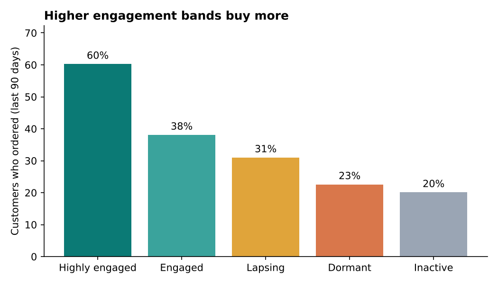
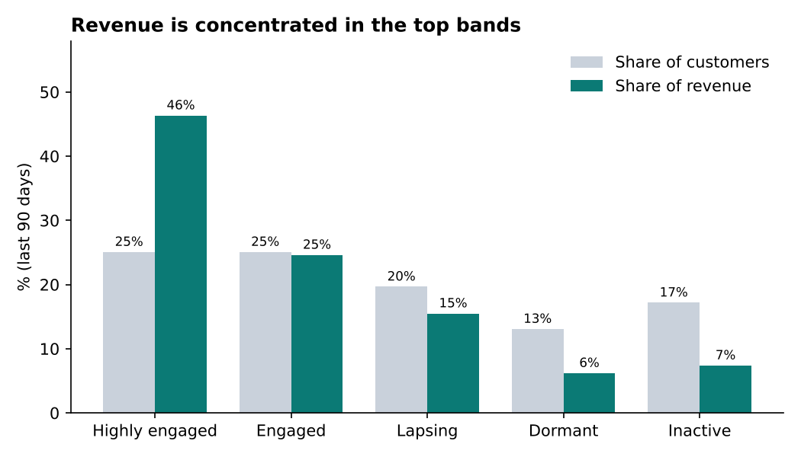
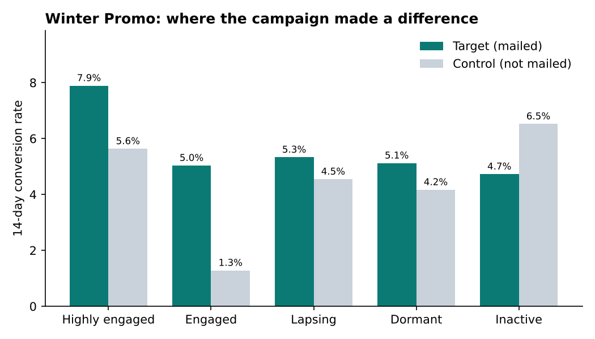

# Email engagement & lead scoring

Scoring customers and leads on behaviour, then using the score to make channel and sales decisions, and proving it works with a control group.

> Built on synthetic data. Inspired by approaches I've used in industry, rebuilt from scratch with no employer data, code or rules.

---

## The problem
Most CRM programmes treat every customer the same: everyone gets every email, and print goes out regardless of whether someone would happily read it online. That wastes money on print and postage, and mailing people who never engage hurts deliverability for everyone else. An engagement score gives each customer a simple, explainable measure of how engaged they are right now, so journeys can choose the right channel and the right level of contact for each person.

## What's in here

| Part | What it does | Where | Status |
|---|---|---|---|
| Synthetic data | Generates SFMC-style email data (`_Sent`, `_Open`, `_Click`), orders, a campaign with a 10% control group, and B2B leads | `scripts/generate_data.py` | ✅ Done |
| B2C engagement score | SQL scoring subscribers on recency and frequency of opens and clicks, grouped into five bands | `sql/01_engagement_score.sql` (repo) and `sql/01_engagement_score_sfmc.sql` (SFMC) | ✅ Done |
| Validation & incrementality | Python checks that the score lines up with buying behaviour, and measures campaign lift against the control group | `analysis/validate_score.py` | ✅ Done |
| Decisions | Why each choice was made | `DECISIONS.md` | ✅ Done |
| QA | Pre-build peer review checklist (GDPR, data QA, email quality) | `qa/pre_build_checklist.md` | 🚧 In progress |
| Dynamic content | AMPscript showing content by engagement band | `ampscript/` | 🚧 In progress |
| B2B lead score | SQL combining fit and intent into a lead score with an MQL threshold | `sql/02_lead_score.sql` | 📝 Planned |

## Approach
Every customer we've emailed in the last 6 months gets a score based on what they did with those emails:

- **Every open is worth 1 point**, including repeat opens of the same email, because coming back to an email shows real interest.
- **Every click is worth 3 points** (counted once per email), because clicking shows more intent than opening.
- **Recent activity counts more.** Activity in the last 30 days counts in full, 1–3 months ago counts at 60%, and 3–6 months ago counts at 30%. Anything older than 6 months doesn't count.

The points are added up into one score, and each customer is put into a band:

| Band | Score | Share of base |
|---|---|---|
| Highly engaged | 10+ | 25% |
| Engaged | 4.6–9.9 | 25% |
| Lapsing | 2–4.5 | 20% |
| Dormant | 0.75–1.9 | 13% |
| Inactive | below 0.75 | 17% |

For example, a customer who opened an email twice and clicked it 10 days ago, opened another 2 months ago, and opened one more 4 months ago scores 2 + 3 + 0.6 + 0.3 = **5.9**, so they're **Engaged**.

The 6-month window matches how long SFMC keeps its tracking data, so the score runs straight from live SFMC data with no extra history store. The reasoning behind every rule is in [`DECISIONS.md`](DECISIONS.md).

## Results

### Higher bands buy more


Each band outperforms the one below it. 60% of Highly engaged customers ordered in the last 90 days, compared with 20% of Inactive customers.



The top 25% of customers generate 46% of revenue. Dormant and Inactive make up 30% of the base but only 13% of revenue.

### Campaign lift: directional, not proven


The Winter Promo lifted conversion from 4.2% (control) to 5.8% (mailed): about 37 incremental orders and £3,800. **This is not statistically significant** (p = 0.27), because the control group was only 287 people. Proving a lift this size would need a control of about 1,430 (a base of about 14,300 at a 90/10 split).

By band, the lift is concentrated in Engaged and Highly engaged customers, and mailing Inactive customers showed no benefit. Band-level control groups are small (44–78 people), so these are signals to test further, not conclusions.

### What this does and doesn't prove
The data is synthetic, and the generator links engagement to purchasing. So these results show the **method** works: the scoring, weighting and banding correctly recover real behaviour. They don't prove engagement drives sales in a real business. That needs real data and a properly sized control group, as set out above.

## How the score is used
The score runs as a Query Activity in Automation Studio and writes to a Data Extension, which journeys read to decide each customer's route:

| Band | Journey action | Print? |
|---|---|---|
| Highly engaged | Email only | Never |
| Engaged | Normal programme | Never |
| Lapsing | Re-engagement journey | Allowed |
| Dormant | Light-touch re-engagement email | Allowed |
| Inactive | Print or SMS win-back, or suppress from email to protect deliverability | Allowed |

Keeping Highly engaged and Engaged customers off print paths is where the cost saving comes from. Half the base would never be sent print.

## What I'd do next
- **Test it predictively.** Score customers at one date and measure what they buy afterwards, rather than comparing scores and orders over the same period.
- **Size the control group properly.** Agree the sample size before launch, increase the holdout, or pool results across several campaigns.
- **Account for Apple Mail Privacy Protection.** Automatic opens inflate open counts, so I'd test giving opens less weight, or identifying and excluding machine opens.
- **Check for extreme repeat opens.** If a few people have 20+ opens of one email (forwarding or security scanners), cap opens per email.
- **Add purchase data.** Combine email engagement with recency and value of orders for a fuller customer view.
- **Tune the thresholds.** Review band sizes monthly, and test smooth decay against the time buckets.

## Run it yourself

```bash
pip install -r ../requirements.txt
python scripts/generate_data.py                # creates data/raw/
python scripts/run_sql.py sql/00_smoke_test.sql
python scripts/run_sql.py sql/01_engagement_score.sql --out data/output/engagement_score.csv
python analysis/validate_score.py
```

The SQL is tested locally with DuckDB and written without CTEs so the same shape runs in an SFMC Query Activity. The SFMC version, with T-SQL date functions and the target Data Extension fields, is in `sql/01_engagement_score_sfmc.sql`.

## Use of AI
I used Claude to set up the repo, build the synthetic data generator, and write the SQL and Python from my decisions. The scoring rules, weights, thresholds and bands are my own decisions, logged in `DECISIONS.md`. I reviewed and challenged the code as I would a colleague's: for example, checking whether the recency `CASE` statement double counted, and reconciling bucket totals to confirm it didn't.
